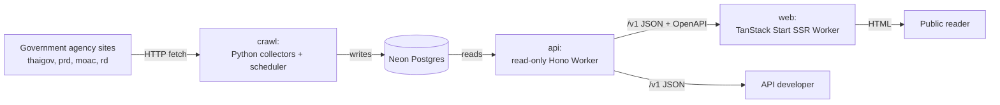
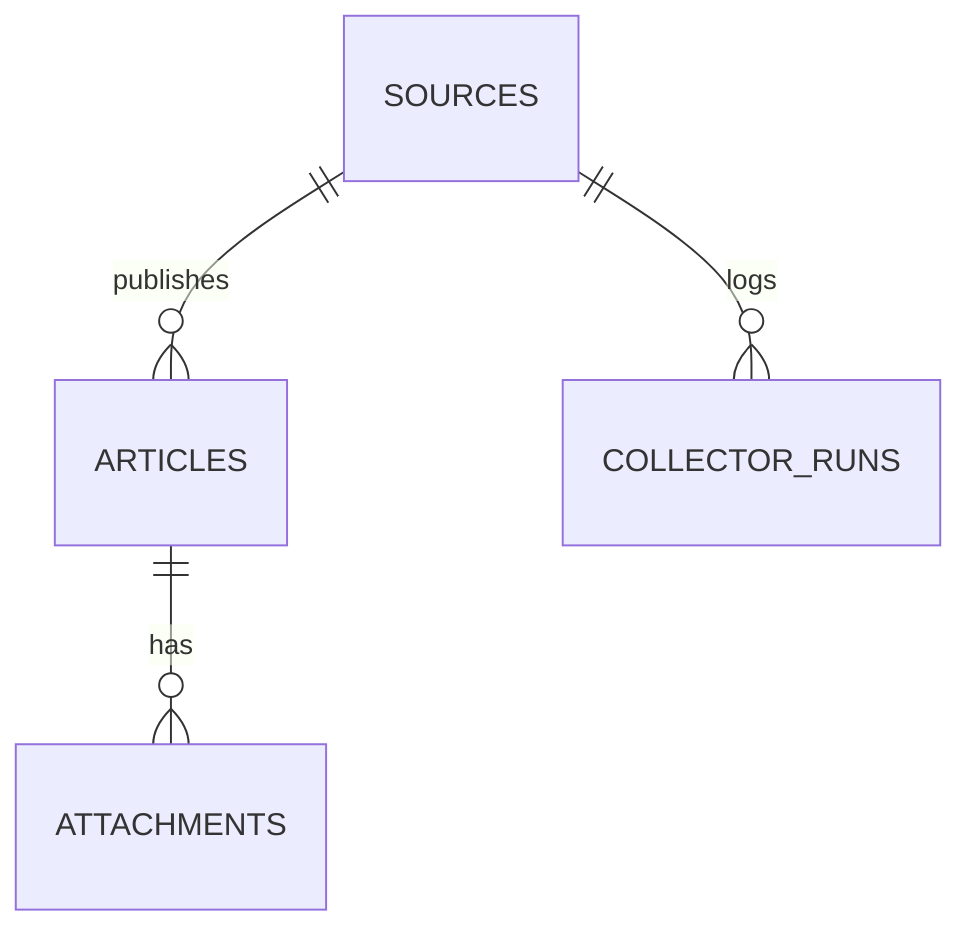

# ARCHITECTURE: สาระรัฐ (Sararath)

System design. Makes structure, boundaries, and trade-offs explicit. Describes the system that exists, not the one intended. Feature IDs (`F*`, `R*`) come from `docs/PRD.md`.

## 01 System Overview

Sararath is a write-once, read-many pipeline. Python crawlers (`crawl/`) are the **only** database writer. They collect Thai government agency pages into a shared Neon Postgres database. A read-only Hono Worker (`api/`) serves that database over HTTP, and a TanStack Start SSR app (`web/`) renders a Thai feed and consumes the API through typed Hono RPC. Crawls run hourly from GitHub Actions for moac/rd/prd and from a residential host for thaigov.



Inside this system: `crawl/`, `api/`, `web/`, and their shared config. External: the government sites, Neon, Cloudflare Workers, GitHub Actions, and the end users.

## 02 Tech Stack

| Layer         | Technology                                                                                        | Why                                                                                                                        |
| ------------- | ------------------------------------------------------------------------------------------------- | -------------------------------------------------------------------------------------------------------------------------- |
| Crawlers (C1) | Python 3.13, uv, SQLAlchemy 2, Alembic, psycopg, httpx, curl_cffi, selectolax, feedparser         | Python is the best fit for scraping/parsing; `curl_cffi` Chrome impersonation gets past thaigov's bot check (ADR-5).       |
| Database (C4) | Neon Postgres (serverless, pooled)                                                                | One managed database shared by crawlers, API, and dev; no local Postgres (ADR-2).                                          |
| API (C2)      | Hono 4, hono-openapi, zod 4, `@neondatabase/serverless`, `drizzle-orm/neon-http`, Wrangler        | HTTP-driver DB access suits Workers; Hono exports `AppType` so the web client is typed without a generated schema (ADR-4). |
| Web (C3)      | TanStack Start + Router + Query, React 19, Vite, Tailwind v4, Base UI, unpic, embla, lucide-react | SSR on Workers with file-route loaders; `hc<AppType>` for RPC.                                                             |
| Tooling       | Bun workspaces, mise tasks, lefthook, oxc (oxlint/oxfmt), ruff, pyright, commitlint               | One gate set for both languages; see `AGENTS.md`.                                                                          |
| Hosting       | Cloudflare Workers for `api` and `web`; GitHub Actions for scheduled crawls                       | Workers have no cold start; Actions cannot reach thaigov (ADR-5).                                                          |

Versions live in `crawl/pyproject.toml`, `api/package.json`, and `web/package.json`.

## 03 Project Structure

```txt
crawl/                 C1 — the only DB writer
  src/sararath/
    cli.py             command entry (seed, crawl, crawl-due, check, maintenance)
    database.py        engine + session factory (DATABASE_URL required)
    models.py          SQLAlchemy entities (D1–D4)
    collectors/        base, http, html, rss, prd, moac, thaigov
    pipeline/          runner (collect→ingest→store), scheduler, ingest, seed
    domain/            normalize, thai_date, links, images, dedupe
    maintenance/       backfill, cleanup, export_legacy
  migrations/          Alembic (schema owner)
  sources/sources.yaml source registry
api/                   C2 — read-only Worker
  src/index.ts         worker entry + app; mounts routes at /v1; /openapi.json; /docs
  src/routes/          one file per resource; __root mounts prefixes
  src/db/              client, row helpers, queries/ per resource, generated/schema.ts
  src/schemas.ts       zod response + query schemas
web/                   C3 — SSR frontend
  src/routes/          index (feed), news (browse/search), articles.$id (detail), __root
  src/components/      ui/ layout/ filters/ feed/ news/
  src/lib/api.ts       hc<AppType> RPC client
  src/assets/css/      theme.css (@theme tokens), base.css, utilities.css
tools/oxlint/          shared oxlint JS plugins
.github/workflows/     ci.yml (gates), crawl.yml (hourly crawl-due)
```

Root holds the glue: `package.json` (bun workspaces `api`, `web`), `mise.toml`, `lefthook.yml`, `compose.yaml`, `compose.dev.yaml`, `.oxlintrc.json`, `.oxfmtrc.json`, `commitlint.config.mjs`.

## 04 Data Architecture

Schema is owned by Alembic in `crawl/migrations/`; `api/src/db/generated/schema.ts` is generated from the live DB with `drizzle-kit pull` and is never hand-edited (ADR-3).

- **D1 Source** (`sources`): `id` UUID PK, `slug` unique, `name_th`, `name_en`, `agency_type`, `homepage_url`, `feed_url` nullable, `collector`, `enabled`, `crawl_interval_minutes`, `category`, `last_attempt_at`, `last_success_at`, `last_error`, `robots_ok`.
- **D2 Article** (`articles`): `id` UUID PK, `source_id` FK→Source, `external_id`, `canonical_url` unique, `title`, `summary` nullable, `body_text`, `language` (default `th`), `category`, `agency_name`, `published_at` nullable, `published_raw`, `updated_at`, `first_seen_at`, `last_seen_at`, `content_hash`, `raw_path`. Unique `(source_id, external_id)`; index `(published_at, id)`.
- **D3 Attachment** (`attachments`): `id` UUID PK, `article_id` FK→Article, `url`, `media_type` nullable, `title` nullable, `checksum` nullable. Stores image URLs (rows with zero attachments render without images, R3.2).
- **D4 CollectorRun** (`collector_runs`): `id` UUID PK, `source_id` FK→Source, `started_at`, `finished_at` nullable, `status`, `http_status` nullable, `found_count`, `inserted_count`, `skipped_count`, `error` nullable. Backs source health.



Ownership: `crawl/` writes all four tables. `api/` reads `sources`, `articles`, `attachments`, `collector_runs` and never writes (R2.1).

## 05 Data Flow

### Write path (crawl)

1. Scheduler picks due sources: `now - last_success_at >= crawl_interval_minutes` (`crawl/src/sararath/pipeline/scheduler.py`).
2. `run_crawl` dispatches to the source's collector (thaigov/prd dedicated, moac/rd generic RSS), fetches and parses pages (`runner.py`).
3. `filter_broken_attachments` drops image URLs that do not resolve; `ingest` normalizes and dedupes in-process (`pipeline/ingest.py`, `domain/`).
4. `_store_articles` collapses same-story rows, updates `last_seen_at` on known rows, and inserts fresh ones; raw HTML/JSON is saved under `raw/` for prd/thaigov.
5. A `CollectorRun` row is written (status `ok` or `error`), and `last_success_at` / `last_error` update on the Source.

### Critical read path (reader opens `/`)

1. `web/src/routes/index.tsx` loader calls `context.queryClient.query(feedQuery(...))` during SSR.
2. `web/src/utils/feed.ts` → `web/src/lib/api.ts` issues `hc<AppType>` `GET /v1/articles?limit=20` to `VITE_API_URL`.
3. The Hono Worker (`api/src/index.ts`) applies CORS, mounts `routes` at `/v1`; `routes/articles.ts` validates the query (zod) and calls `api/src/db/queries/articles.ts`.
4. `getDb(env)` builds `drizzle(neon(env.DATABASE_URL))` and queries Neon over HTTP.
5. Rows join `sources`, map through `toArticle`, and return `{ items, next_cursor }`; the loader renders HTML and hydrates React Query for cursor paging.

## 06 Auth & Authorization

None. There is no authentication and no user account model.

- **API:** public and read-only; only `GET` is allowed (CORS `allowMethods: ['GET']`). Every route reads, none writes (R2.1).
- **Web:** public; no sessions or protected routes.
- **Database:** a single `DATABASE_URL` credential per caller. Write capability lives only in the `crawl/` credential used by Actions and the scheduler; the Worker's secret is used for reads.
- **Deploy:** Cloudflare `wrangler secret put DATABASE_URL`; CI uses the `DATABASE_URL` GitHub secret. No role separation inside the DB.

## 07 Integrations

- **I1: Neon Postgres.** Read by `api` (`postgresql://` scheme) and dev web; written by `crawl` (`postgresql+psycopg://` scheme, ADR-2). Failure: API returns `{detail}` with 503 on DB error; crawl records status `error` and retries next tick.
- **I2: Cloudflare Workers.** Hosts `api` (`sararath-api`, custom domain `sararath-apis.fasu.dev`) and `web` (`sararath.fasu.dev`). Deploy on push to `main` via Workers Builds. Failure: the web app shows its feed-error state (R3.3); no cold start.
- **I3: GitHub Actions.** `crawl.yml` runs `crawl-due --source moac --source rd --source prd` hourly (`cron: 15 * * * *`), plus `ci.yml` runs the gates on PRs. Failure: a source stays stale until the next tick; `M1` detects it.
- **I4: Agency sites (thaigov, prd, moac, rd).** Fetched over HTTP. thaigov's API returns 403 to datacenter IPs, so it is crawled from a residential/TH host (ADR-5). `http.py` adds per-host rate limiting, retry/backoff, and a `curl_cffi` impersonation fallback. Failure: the collector logs an error and skips; existing rows remain.
- **I5: OpenAPI / Scalar docs.** `/openapi.json` is generated at request time from route metadata; `/docs` renders it with Scalar. Nothing is committed. It exists for public consumers, not for the web client (ADR-4).

## 08 Scalability & Constraints

- **Read-heavy, write-light.** Writes are a few hundred rows per hour; reads dominate. Neon's HTTP driver and Workers' no-cold-start model absorb this without connection pooling by the app.
- **First bottleneck:** `GET /v1/articles?q=` uses SQL `LIKE '%…%'` over `title`, `body_text`, and `agency_name` (`queries/articles.ts`). It cannot use an index and degrades as `articles` grows. Add Postgres full-text search or a trigram index (`pg_trgm`) when search latency matters. Cursor pagination and the `(published_at, id)` index keep list reads bounded.
- **Images are hotlinked** from agency hosts, so availability depends on those hosts; there is no image cache or proxy.
- **Constraints:**
  - No local Postgres; dev, Actions, and prod share one Neon database (ADR-2). Local writes hit production.
  - `DATABASE_URL` scheme differs by caller: `postgresql+psycopg://` (crawl) vs `postgresql://` (api).
  - thaigov must run from a residential/TH host (ADR-5).
  - CORS defaults to `*` (`CORS_ORIGINS` var).
  - Schema changes require an Alembic migration plus a `db:pull` to refresh the Drizzle schema (ADR-3).

## Architecture Decisions

### ADR-1: Python crawlers own the schema; the API is read-only

- **Status:** accepted
- **Context:** Two languages touch one database. A second writer would need conflict handling and would double the migration burden.
- **Decision:** `crawl/` owns `models.py` and Alembic migrations and is the only writer. `api/` reads through Drizzle.
- **Alternatives:** Let the API write (rejected: no need; a read API is simpler and safer); two language-owned schemas (rejected: drift).
- **Consequences:** One migration owner. The Worker needs no write path or transactions. Schema changes require coordinating both sides.

### ADR-2: One Neon database shared by dev, CI, and prod

- **Status:** accepted
- **Context:** The data is real agency news; a local database would start empty and drift.
- **Decision:** Dev, GitHub Actions, and production share the Neon `DATABASE_URL`. There is no local Postgres.
- **Alternatives:** Local Postgres in compose (rejected: empty data, drift, extra service); per-env databases (rejected: cost and seeding).
- **Consequences:** Local runs and tests with real data work immediately. Local writes hit production, a real risk (see `AGENTS.md`).

### ADR-3: Drizzle schema generated with `drizzle-kit pull`, not hand-written

- **Status:** accepted
- **Context:** The Worker needs typed table access, but the schema already belongs to Alembic.
- **Decision:** `api/src/db/generated/schema.ts` is produced by `drizzle-kit pull` from the live DB and is never hand-edited. Alembic remains the single migration owner; no `drizzle-kit push`/`migrate`.
- **Alternatives:** Hand-write Drizzle tables (rejected: drift); use Drizzle as the migration owner (rejected: Python writes need SQLAlchemy types).
- **Consequences:** One caveat: after any migration, rerun `mise run api:db:pull`.

### ADR-4: Hono RPC (`AppType`) instead of a generated OpenAPI client

- **Status:** accepted
- **Context:** The web client needs request/response types for the API.
- **Decision:** `web` imports `AppType` from `@sararath/api` and builds `hc<AppType>(API_URL)`. The OpenAPI document is generated only to serve `/docs` and public consumers.
- **Alternatives:** Generate types from OpenAPI (rejected: an extra build step and a committed artifact; RPC types are end-to-end).
- **Consequences:** Types stay in sync automatically, but `web/tsconfig.json` must resolve `@api/*` and the Worker must not add runtime-only imports that break the web DOM program.

### ADR-5: thaigov is crawled from a residential/TH host

- **Status:** accepted
- **Context:** thaigov's API returns 403 to datacenter IPs (Cloudflare bot protection), so GitHub Actions cannot fetch it.
- **Decision:** Actions crawls only moac/rd/prd. thaigov runs from a residential/TH host via the `scheduler-thaigov` compose profile.
- **Alternatives:** Route Actions through a proxy (rejected: cost/complexity); drop thaigov (rejected: it is a primary source).
- **Consequences:** One source depends on a machine outside CI; if that host is down, thaigov goes stale (M1 tracks it).

### ADR-6: No authentication

- **Status:** accepted
- **Context:** The product is a public index of public announcements; there are no private users or writes.
- **Decision:** No authn/authz anywhere. The API is public and GET-only; the web app is public.
- **Alternatives:** API keys (rejected: no need; would block open use).
- **Consequences:** Minimal attack surface. Abuse control is limited to CORS and Cloudflare; if rate limiting is needed, it belongs at the edge.
